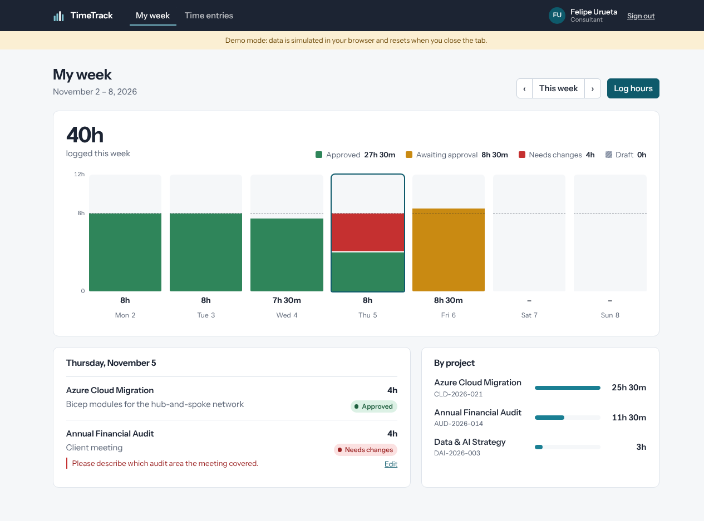
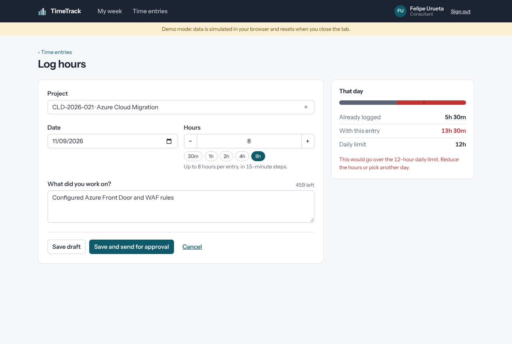
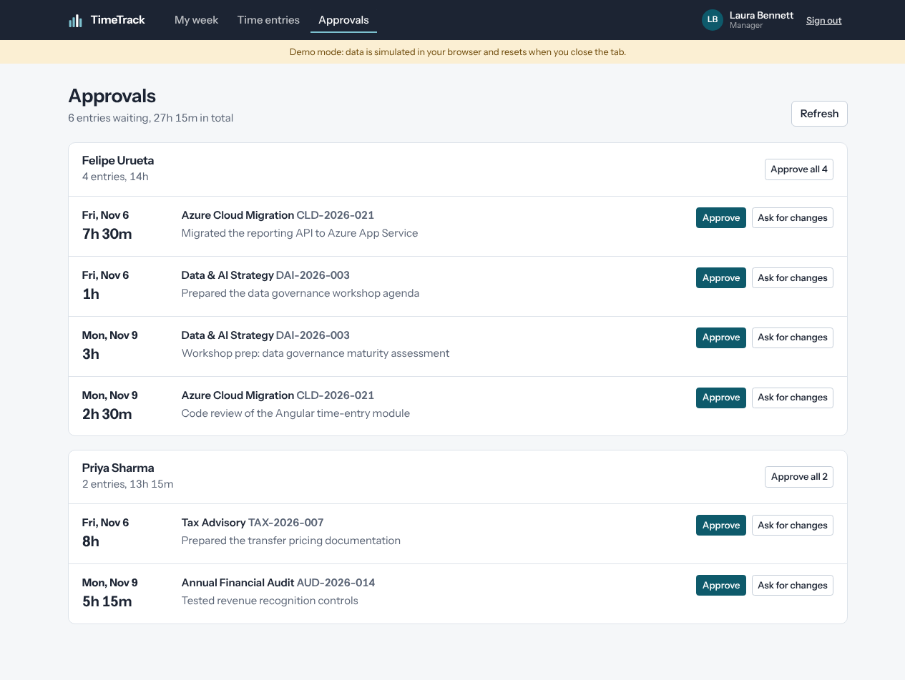
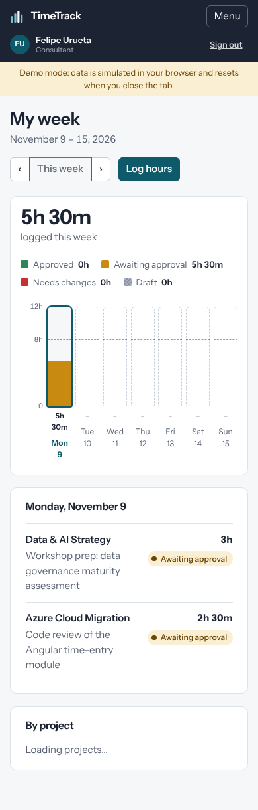
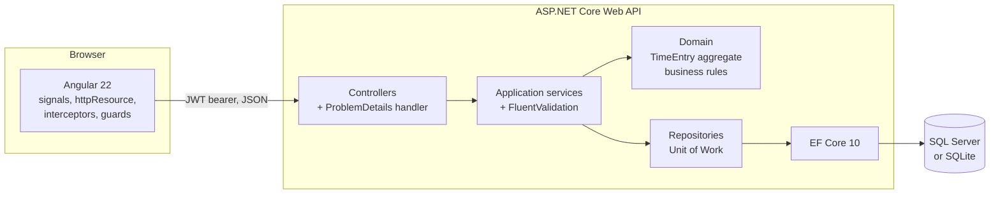

# TimeTrack

Timesheet and approval platform for a professional services firm. Consultants log hours against client projects, send their week for approval, and managers approve or send entries back with a note.

Full stack: **ASP.NET Core Web API (.NET 10)** with Clean Architecture, and an **Angular 22** front end built with signals, standalone components and zoneless change detection.



| Log hours | Approvals | Mobile |
| --- | --- | --- |
|  |  |  |

## Run it

### Option 1: front end only, in demo mode (fastest)

No API needed. An HTTP interceptor answers every call from an in-memory database that applies the same business rules and returns the same error format as the API.

```bash
cd timetrack-web
npm install
npm run start:mock
# http://localhost:4200
```

### Option 2: API + front end on your machine

```bash
# Terminal 1: API on http://localhost:5080 (SQLite file, demo data seeded on startup)
cd timetrack-api
dotnet run --project src/TimeTrack.Api
# API reference (Scalar UI): http://localhost:5080/scalar/v1

# Terminal 2: Angular on http://localhost:4200, pointing at the API
cd timetrack-web
npm install
npm start
```

### Option 3: everything in Docker, with SQL Server

```bash
docker compose up --build
# Web: http://localhost:8080   API: http://localhost:5080/health
```

### Demo accounts

| Email | Role | Password |
| --- | --- | --- |
| `consultant@timetrack.dev` | Consultant (Felipe Urueta) | `Demo123!` |
| `manager@timetrack.dev` | Manager (Dummy Manager) | `Demo123!` |

## Architecture

Flow diagrams (user flow, entry lifecycle, request path): [docs/FLOW.md](docs/FLOW.md).



```
timetrack-api/
  src/
    TimeTrack.Domain/          Entities and business rules. No dependencies at all.
    TimeTrack.Application/     Use cases, DTOs, validators, repository interfaces.
    TimeTrack.Infrastructure/  EF Core, repositories, JWT, password hashing, seeding.
    TimeTrack.Api/             Controllers, auth, error handling, rate limiting, OpenAPI.
  tests/
    TimeTrack.Domain.Tests/            Business rules as executable specs (no mocks needed).
    TimeTrack.Application.Tests/       Use cases with mocked repositories (NSubstitute).
    TimeTrack.Api.IntegrationTests/    Real HTTP calls through WebApplicationFactory.

timetrack-web/src/app/
  core/       API contracts, auth (service, interceptor, guards), layout, toasts, demo backend.
  shared/     Pure pieces: hours pipe, status badge, date helpers, validators.
  features/   One folder per screen, each lazy loaded: login, week, entries, approvals.
```

Dependencies point inward: Api → Infrastructure → Application → Domain. The domain can be tested and changed without touching EF Core or ASP.NET Core.

## Business rules

All of them live in the `TimeEntry` aggregate (and are mirrored in the Angular demo backend):

- Hours are logged in 15-minute steps, from 0.25 to 8 per entry.
- A person can't log more than 12 hours on the same day.
- Hours can't be logged for a future date, and only against active projects.
- Lifecycle: **Draft → Submitted → Approved**, or **Submitted → Rejected → (edit) → Draft → Submitted**.
- Only drafts can be deleted; approved and submitted entries can't be edited.
- Only managers review, a reason is required to reject, and nobody can review their own entries.

## Design decisions

| Decision | Why |
| --- | --- |
| Clean Architecture with a rich domain model | Business rules live in one place (`TimeEntry`) and can't be bypassed: state only changes through methods like `Submit()` and `Approve()`. |
| Optimistic concurrency with a `ConcurrencyStamp` | Two people editing the same entry get a `409 Conflict` instead of silently overwriting each other. A Guid stamp behaves the same on SQL Server and SQLite. |
| `ProblemDetails` (RFC 7807) for every error | One error format for the client: `400` with field errors, `422` with a business `code`, `401`, `403`, `404`, `409`. The Angular form maps `400` errors straight onto its controls. |
| Secure by default | A fallback authorization policy protects every endpoint unless it is marked `[AllowAnonymous]`. Login is rate limited. Users can't learn other users' entry ids (404, not 403). |
| No MediatR, no AutoMapper | Plain services and explicit mappings are easy to read and debug, and avoid commercial licensing changes in those libraries. |
| `TimeProvider` instead of `DateTime.Now` | Tests control the clock, so date rules are tested deterministically. |
| Angular signals + `httpResource` for reads | Screens re-fetch automatically when their inputs change (week, filters), with loading and error states as signals and no manual subscriptions. |
| RxJS where streams matter | The project search uses `debounceTime` + `distinctUntilChanged` + `switchMap`, so old responses never overwrite new ones. |
| Zoneless + `OnPush` everywhere | Change detection only runs where a signal or event changed something. |
| Self-hosted font, no CDN | Works offline, behind corporate proxies and with a strict Content Security Policy. |

## Tests

```bash
cd timetrack-api && dotnet test          # domain, application and integration tests
cd timetrack-web && npm run test:ci      # 35 Vitest specs
```

The Angular tests cover the interceptor (token only sent to our API, 401 handling), the project picker (debounce and request cancellation with fake timers), the week chart, validators and the demo backend's business rules.

## Deploy the demo

`.github/workflows/deploy-demo.yml` publishes the Angular app in demo mode to GitHub Pages on every push to `main`. It runs the unit tests first, then builds with `npm run build:demo` (simulated API, hash routes, relative paths, so it works from any subfolder).

One-time setup in the GitHub repository: **Settings › Pages › Build and deployment › Source: GitHub Actions**. The demo is then available at `https://<your-user>.github.io/<repo-name>/`.

## CI/CD

`azure-pipelines.yml` runs on every pull request to `main` and `develop`: restore, build, unit and integration tests with code coverage for the API; install, Vitest and production build for the Angular app. Both jobs run in parallel and publish their build artifacts.

## Notes

- **Database migrations.** On the first run the schema is created automatically. To switch to EF Core migrations: `dotnet ef migrations add InitialCreate -p src/TimeTrack.Infrastructure -s src/TimeTrack.Api`. From then on the app applies migrations on startup instead.
- **Package versions.** Central Package Management (`Directory.Packages.props`) keeps every NuGet version in one file. If a version isn't available in your feed, update it there.
- **Secrets.** The development JWT key in `appsettings.Development.json` is for local use only. In Azure, the key and connection string come from Key Vault through Managed Identity.

## What I would add next

- Refresh tokens and sign-in with Microsoft Entra ID (OpenID Connect).
- Teams, so managers only see their own team's queue.
- A CSV export of approved hours for billing.
- Deployment stage in the pipeline to Azure App Service (API) and Azure Static Web Apps (front end).
