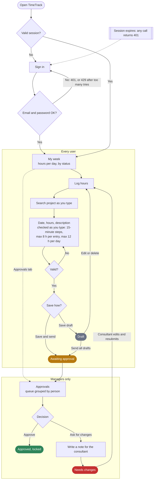
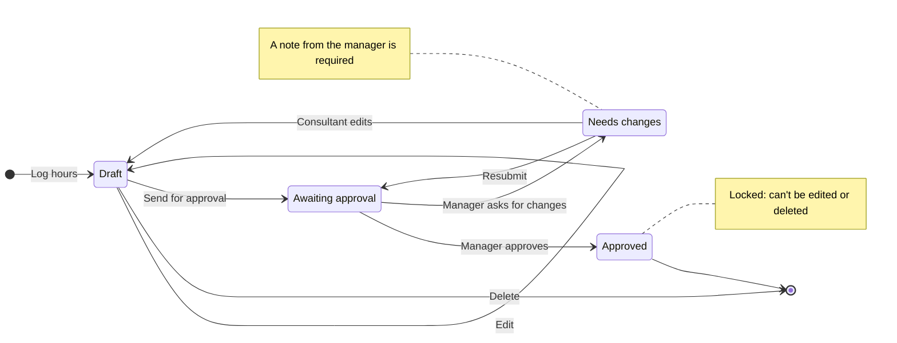
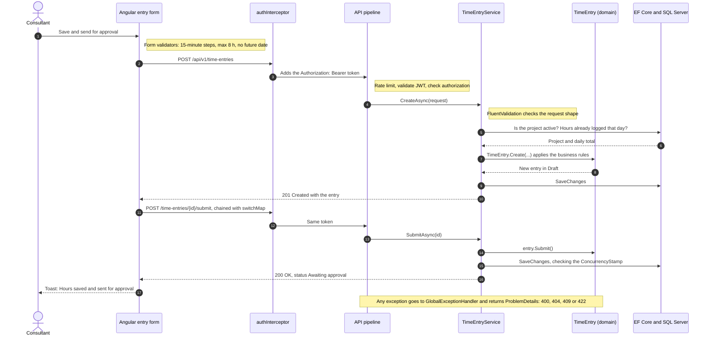

# TimeTrack flow

The Mermaid sources also live in `docs/diagrams/*.mmd`. To edit them in draw.io: Arrange › Insert › Advanced › Mermaid.

## User flow

Every user logs hours from My week. Managers also get the Approvals tab, where submitted entries arrive grouped by person.

## Entry lifecycle

Status only changes through methods on the `TimeEntry` aggregate, so these are the only transitions the API allows.

## Saving an entry, step by step

Angular checks the form first for fast feedback; the API checks everything again because it is the source of truth.

| Response | Cause | What the user sees |
| --- | --- | --- |
| 400 | The request is malformed (FluentValidation) | The message under the matching form field |
| 401 | Token missing or expired | The interceptor ends the session and opens Sign in |
| 403 | A consultant calls an approvals endpoint | Nothing: the Approvals tab is hidden, and the API refuses anyway |
| 404 | The entry doesn't exist or belongs to someone else | "This entry doesn't exist or you can't open it" |
| 409 | Someone changed the entry since it was loaded | A warning with a Reload entry button |
| 422 | A business rule is broken, e.g. more than 12 h in one day | The rule's message above the form |
| 429 | Too many sign-in attempts from the same address | An error on the Sign in page |
